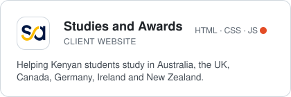
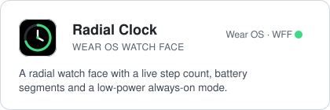
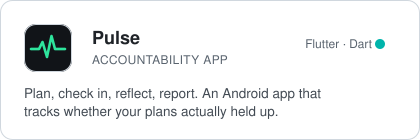

<picture>
  <source media="(prefers-color-scheme: dark)" srcset="assets/header-dark.svg">
  
</picture>

  <a href="https://www.linkedin.com/in/gilmore-collins-0456a3245/"><picture><source media="(prefers-color-scheme: dark)" srcset="assets/btn-linkedin-dark.svg"></picture></a>
  <a href="https://x.com/gilmorecollins"><picture><source media="(prefers-color-scheme: dark)" srcset="assets/btn-x-dark.svg"></picture></a>
  <a href="https://dev.to/gilmorecollins"><picture><source media="(prefers-color-scheme: dark)" srcset="assets/btn-devto-dark.svg"></picture></a>
  <a href="https://instagram.com/gilmore.collins"><picture><source media="(prefers-color-scheme: dark)" srcset="assets/btn-instagram-dark.svg"></picture></a>

 

### Selected work

  <a href="https://github.com/Gilmorecollins/Eclipse-releases/releases">
    <picture>
      <source media="(prefers-color-scheme: dark)" srcset="assets/card-eclipse-dark.svg?v=2">
      
    </picture>
  </a>
  <a href="https://github.com/Gilmorecollins/Studies-and-Awards-Limited">
    <picture>
      <source media="(prefers-color-scheme: dark)" srcset="assets/card-studies-dark.svg">
      
    </picture>
  </a>
  <a href="https://github.com/Gilmorecollins/Clock-UI">
    <picture>
      <source media="(prefers-color-scheme: dark)" srcset="assets/card-clock-dark.svg">
      
    </picture>
  </a>
  <a href="https://github.com/Gilmorecollins/Pulse">
    <picture>
      <source media="(prefers-color-scheme: dark)" srcset="assets/card-pulse-dark.svg">
      
    </picture>
  </a>

 

### Stack

<picture>
  <source media="(prefers-color-scheme: dark)" srcset="assets/stack-dark.svg">
  
</picture>
