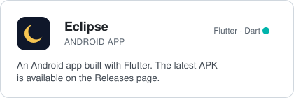
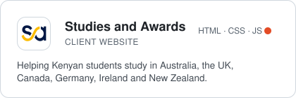

<h1>Gilmore Collins</h1>

  <strong>Mobile and web developer in Nairobi.</strong> 
  I design products in Figma, then build them end to end: Flutter apps for Android,
  and fast, responsive websites for businesses.

  <a href="https://www.linkedin.com/in/gilmore-collins-0456a3245/">LinkedIn</a> &nbsp;·&nbsp;
  <a href="https://x.com/gilmorecollins">X</a> &nbsp;·&nbsp;
  <a href="https://dev.to/gilmorecollins">dev.to</a> &nbsp;·&nbsp;
  <a href="https://instagram.com/gilmore.collins">Instagram</a>

 

### Selected work

  <a href="https://github.com/Gilmorecollins/Eclipse-releases/releases">
    <picture>
      <source media="(prefers-color-scheme: dark)" srcset="assets/card-eclipse-dark.svg">
      
    </picture>
  </a>
  <a href="https://github.com/Gilmorecollins/Studies-and-Awards-Limited">
    <picture>
      <source media="(prefers-color-scheme: dark)" srcset="assets/card-studies-dark.svg">
      
    </picture>
  </a>

 

### Stack

<picture>
  <source media="(prefers-color-scheme: dark)" srcset="https://skillicons.dev/icons?i=flutter,dart,java,ts,js,vue,nuxtjs,html,css,firebase,mongodb,sqlite,azure,figma,git,linux&theme=dark&perline=16">
  
</picture>

  

### Currently

- Shipping new releases of **Eclipse** for Android
- Building out **Studies and Awards**, from the website to the AI tooling behind it
- Open to freelance and contract work: mobile apps, business websites, UI design
